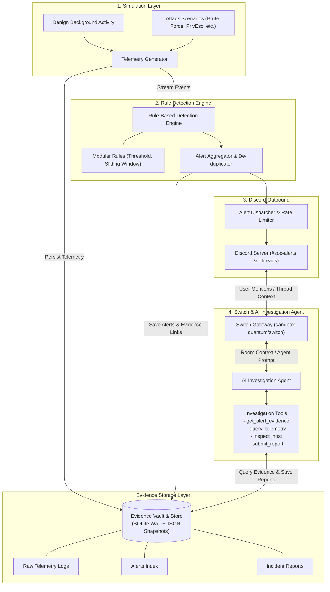
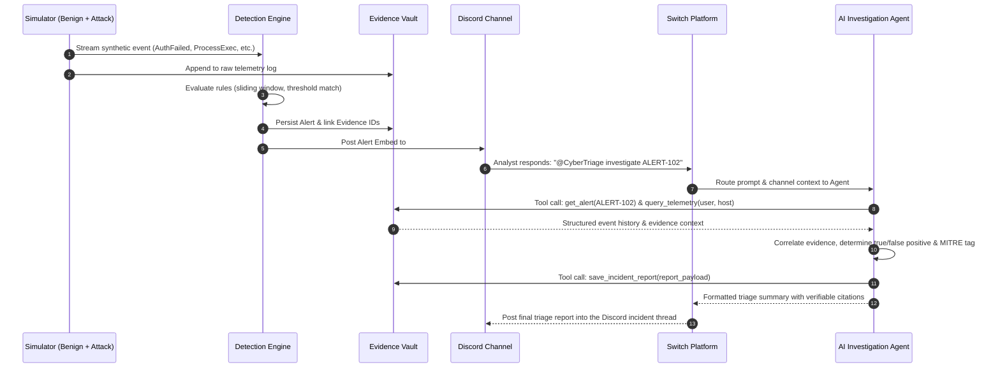

# CyberTriage Project Architecture & Specification

## 1. Project Overview & Scope
**CyberTriage** is a simulated cybersecurity triage environment that bridges detection telemetry with a Switch-connected AI investigation agent inside Discord.

### Core Principles
1. **Simulation-Only Boundary:** Synthetic telemetry generated locally; no active network probes, external scans, or offensive actions.
2. **Discord-First UI:** Discord channels and incident threads serve as the primary human-in-the-loop interface.
3. **Strict Separation of Concerns:** Deterministic detection engine is kept strictly separated from the stochastic AI investigation agent.
4. **Switch Orchestration:** Switch (`sandbox-quantum/switch`) bridges Discord users and incident channels to the AI Agent.
5. **Verifiable Evidence Grounding:** AI incident reports must cite concrete evidence IDs from telemetry.

---

## 2. System Architecture



---

## 3. Modular Folder Structure

```
CyberTriage/
├── .env.example                  # Environment variable template
├── .gitignore                    # Standard Python gitignore
├── README.md                     # Setup, architecture, and run instructions
├── ARCHITECTURE.md               # Detailed architectural specification
├── requirements.txt              # Pinned dependencies
├── data/                         # Local storage sink
│   ├── raw_logs/                 # Simulated log sink (JSONL)
│   ├── alerts/                   # Saved alert records
│   ├── evidence/                 # Snapshot evidence bundles
│   └── reports/                  # Generated incident reports (JSON & Markdown)
├── src/
│   ├── __init__.py
│   ├── config.py                 # Configuration settings
│   ├── common/                   # Shared schemas
│   │   ├── __init__.py
│   │   ├── events.py             # Event dataclasses / Pydantic models
│   │   ├── alerts.py             # Alert and severity schemas
│   │   └── reports.py            # Evidence-grounded report schemas
│   ├── simulator/                # Synthetic event generation
│   │   ├── __init__.py
│   │   ├── generator.py          # Event loop & emitter
│   │   ├── scenarios.py          # Pre-built attack scenarios
│   │   └── benign.py             # Background benign noise
│   ├── engine/                   # Rule-based detection
│   │   ├── __init__.py
│   │   ├── detector.py           # Stream evaluation engine
│   │   ├── rules/                # Pluggable detection rules
│   │   │   ├── __init__.py
│   │   │   ├── base.py           # BaseRule abstract class
│   │   │   ├── auth_rules.py     # Brute force, impossible travel
│   │   │   └── process_rules.py  # Suspicious parent-child executions
│   │   └── aggregator.py         # Alert throttling & de-duplication
│   ├── storage/                  # Storage & Evidence Vault
│   │   ├── __init__.py
│   │   ├── database.py           # SQLite connection & WAL management
│   │   └── evidence_vault.py     # Query interface for historical logs & evidence
│   ├── notifications/            # Discord integration
│   │   ├── __init__.py
│   │   ├── discord_client.py     # Webhook / REST sender with rate limiting
│   │   └── formatters.py         # Rich Discord Embed builders
│   ├── agent/                    # AI Investigation Agent
│   │   ├── __init__.py
│   │   ├── investigator.py       # Core prompt & reasoning loop
│   │   ├── tools.py              # Investigation tools bound to evidence vault
│   │   └── report_builder.py     # Verifiable citation validator & report builder
│   ├── switch_bridge/            # Switch Gateway Connector
│   │   ├── __init__.py
│   │   ├── connector.py          # Switch room listener / MCP bridge
│   │   └── handlers.py           # Message router between Discord & Investigator
│   └── main.py                   # Orchestration CLI
└── tests/
    ├── __init__.py
    ├── test_simulator.py         # Event generation unit tests
    ├── test_engine.py            # Detection rule true/false positive tests
    ├── test_storage.py           # Evidence store & query tests
    └── test_agent_tools.py       # Investigation tool tests
```

---

## 4. End-to-End Data Flow



1. **Telemetry Generation:** `simulator` generates benign background events along with attack scenarios.
2. **Rule Matching:** `engine` triggers an alert when thresholds or correlation patterns match.
3. **Evidence Persistence:** Raw events and alert payloads are indexed in `EvidenceVault`.
4. **Discord Notification:** `notifications` posts an alert embed to `#soc-alerts` creating a dedicated thread.
5. **Switch Gateway Ingestion:** Analyst prompts the agent inside Discord; Switch forwards context to the agent.
6. **Tool Execution:** Agent executes read-only queries against `EvidenceVault` (`get_alert_evidence`, `query_telemetry`, etc.).
7. **Evidence-Grounded Reporting:** Agent generates a report referencing exact evidence IDs, returning the verdict to Discord.

---

## 5. Critical Technical Risks & Mitigations

| Risk | Cause | Impact | Mitigation Strategy |
| :--- | :--- | :--- | :--- |
| **Python 3.14 Bleeding Edge** | Current venv runs pre-release Python 3.14.8 | Package wheel failures, C-extension build errors | Re-create virtual environment with Python 3.11/3.12 if wheels fail. |
| **Switch vs. Discord Ambiguity** | Both engine and Switch interacting with Discord | Double-bot confusion, thread mismatch | Engine sends outbound alert webhooks; Switch handles interactive bot thread conversations. |
| **"No-Noise" Trap** | Generator only outputs attacks | Trivial 100% TP alerts; no triage challenge | Generator emits background benign events (cron, routine auth, admin work). |
| **Storage Concurrency** | Engine, simulator, and agent accessing flat files | JSON corruption, file locking contention | SQLite with WAL mode enabled + atomic JSON export snapshots. |
| **AI Hallucinations** | LLMs inventing malicious findings | Fabricated incident reports | Strict tool schemas requiring direct `evidence_id` citations for every assertion. |
| **Discord Rate Limits** | High event volume triggering alert floods | HTTP 429 throttling / IP block | In-memory sliding-window alert aggregator and severity batcher. |

---

## 6. Required Dependencies

* **Core Schemas:** `pydantic >= 2.0`
* **HTTP & Webhooks:** `requests` (already installed in venv)
* **Configuration:** `python-dotenv` (already installed in venv)
* **Database:** `sqlite3` (Python standard library)
* **Agent Integration:** LLM client (`google-genai`, `openai`, or `anthropic`) + MCP SDK (if using MCP with Switch)
* **Testing:** `pytest`
